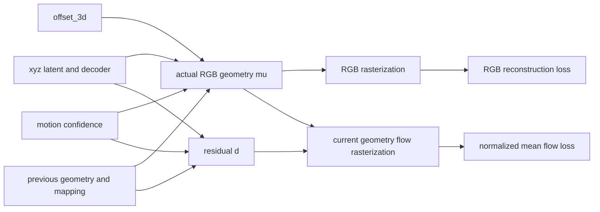

# 阶段 01：MoRGS 环境与源码审计

**续跑更新：官方核心环境、全部算子及预训练教师最小调用已打通，阶段 01 继续门槛通过。最新结果见 [环境恢复报告](phase01_environment_recovery.md)。下文保留首轮审计历史，PARTIAL 和依赖未获取的描述对应 23:09 前的状态。**

本阶段从 2026-10-10 22:33（Asia/Shanghai）开始。范围是既有方案中的阶段 01，并提前盘点本地数据；没有重新启动旧的九小时文献任务，也没有执行阶段 02—05 的训练。最终时间和状态以 `experiment_state.json` 为准。

**结论：源码与关键计算路径已经审计，GPU 微小测试通过；阶段状态为 PARTIAL，训练继续门槛尚未通过。** 固定版本可以作为研究起点，但不宜直接用默认 README 命令开展监督结构比较。已复现 CUDA 更新掩码步长错误并验证独立修复；另有流尺度、实际位置与残差定义、数据加载及恢复状态问题需要在完整环境中处理。没有获得 PSNR、FPS、真实训练峰值显存或场景训练耗时。

## 1. 已核实的本机条件

| 项目 | 实测／检查结果 |
|---|---|
| GPU | RTX 4090，nvidia-smi 总量 24564 MiB，WDDM |
| 驱动 | 616.92；驱动显示 CUDA UMD 13.4 不代表本机编译 toolkit 为 13.4 |
| 系统 toolkit | CUDA 11.8，nvcc 可定位 |
| 编译器 | Visual Studio 2019 Community，vcvars64 可用 |
| 既有 Ex4DGS 环境 | Python 3.9.25、PyTorch 2.1.2、CUDA runtime 11.8 |
| WSL | 未发现已安装发行版 |
| E 盘空间 | 首轮检查约 1.33 TB 可用 |
| 基础 CUDA 健康 | sin→平方→均值→反向→同步通过，CPU 差约 2.98e-8 |
| 定制 rasterizer | 固定源码在独立诊断 venv 编译成功；微小 SH、RGB、flow 前向反向通过 |
| 官方环境 | 未创建成功：包源 SSL EOF 与 HTTP 超时；安装日志完整保留 |

官方版本依赖以 [固定 environment.yml](https://github.com/LeeWonJoon9868/MoRGS/blob/5c62ae88b8fb2e3d4213329dd1ec3a61c66f8902/environment.yml) 为准：Python 3.10.18、PyTorch 2.5.1、torchvision 0.20.1、CUDA 12.1。本轮尝试了普通 conda 安装和固定包 URL 清单；网络失败后，没有重装驱动、安装系统 CUDA、重启或修改旧训练环境。

诊断环境 `envs/morgs-native-probe` 使用 `--system-site-packages` 只读复用旧 torch，新增包和 native wheel 安装在该 venv。它证明部分源码在当前机器可编译和执行，**不能证明完整 MoRGS 或 SAM2 官方版本已经兼容**。

WDDM 的 nvidia-smi 已用显存约 6.4—6.6 GiB，而 torch `mem_get_info` 的可用量与之不同。二者不能混算；正式训练须同时记录 allocated、reserved、设备使用量和外部负载。微小算子约 0.39 MiB peak allocated 不提供真实场景显存预算。

## 2. 固定源码与可追溯性

仓库：[MoRGS 官方代码](https://github.com/LeeWonJoon9868/MoRGS)。固定 commit 为 `5c62ae88b8fb2e3d4213329dd1ec3a61c66f8902`；GitHub API 查询的 main 与此一致，本轮没有上游差异。

两次 Git 传输失败，改从官方 codeload 获取指定 commit 的 ZIP，SHA256：

`105fa3456b4c8d799f8386e5ed642c5886eab8c6aefcbd4bda26c4ca276a2fd2`。

`sources/MoRGS-5c62ae88b8fb2e3d4213329dd1ec3a61c66f8902` 是解压源码；不是成功克隆的 Git checkout。`source_lock.json` 校验了归档内 3290 个原始文件与磁盘逐一一致，并排除本轮生成的额外 pycache。三个 CUDA 扩展目录均在归档内，根目录没有 `.gitmodules`，不能虚构其独立子模块 SHA。vendored SEA-RAFT/SAM2 的 Python 源码树与配置另有 SHA256。

根目录未发现许可证文件；子目录包含 RAFT 与 rasterizer 许可证及各文件版权说明。研究可执行性与发布许可是两件事；发布源码时需核实项目及第三方各自许可，当前没有推断一个统一 MoRGS 许可证。归档内 Linux `.so` 不用作 Windows 可执行扩展。

## 3. E:\4DGS 数据检查

`E:\4DGS` 的 README 和 Git 信息表明它是 **Ex4DGS**，不是 hustvl/4DGaussians。原仓库 commit 是 `2df57a7462073444c55ec6064b0ea4b67a5d50da`，已有未跟踪研究目录。本轮没有修改原仓库、原视频或已有 checkpoint。

| 场景 | 视频／位姿行数 | 原视频帧数 | 尺寸／FPS | MoRGS 初始化点云 |
|---|---:|---:|---|---|
| coffee_martini | 18 / 18 | 300 | 2704×2028 / 30 | 缺少 |
| cut_roasted_beef | 20 / 20 | 300 | 同上 | 缺少 |
| cook_spinach | 21 / 21 | 300 | 同上 | 缺少 |
| flame_salmon_1 | 19 / 19 | 1200 | 同上 | 缺少 |
| flame_steak | 21 / 21 | 300 | 同上 | 缺少 |
| sear_steak | 21 / 21 | 300 | 同上 | 缺少 |

共 120 个相机，六个 poses 数组均为 `(N,17)`、元素有限；逐视频第 0、89、299 帧抽查可读。这是**原始数据已经在本地**的证据，不等于已经完成 MoRGS 预处理、全部帧完整性或几何正确性验证。

两个开发场景额外做了前 300 帧严格顺序解码。既有 FFmpeg 4.2.2 全部报错；独立下载的 imageio-ffmpeg 0.6.0 中 FFmpeg 7.1，双进程首次扫描 37/38 通过，`cut_roasted_beef/cam10.mp4` 失败。该文件与本地 ZIP 内的字节及 SHA 完全一致；ZIP CRC 通过，之后独立进程的原文件三次和归档副本一次均通过。**目前记录为解码／并发行为待诊断，不判原视频损坏，也不删除相机或替换原文件。** 下一阶段使用固定新版、保守线程并记录每帧抽取结果，遇到失败须停止该相机预处理。

coffee ZIP 本轮重新 CRC 检查通过；其他四场景的全部帧严格解码没有执行。salmon 正式协议仍取预定前 300 帧，不能把原始 1200 帧混进同一预算。

所有场景缺 `points3D_downsample2.ply`。cut 已有相机目录与少量图像／COLMAP 产物，但不是完整 MoRGS 数据树；盘点脚本最初统计了 README 风格的 `images/` 子目录，不能据其计数判断根层 PNG 不存在。已有产物须另查文件名、帧数和初始化来源，不复用 Ex4DGS checkpoint 作为 MoRGS 初始化。

Meet Room 在检查的 `E:\4DGS\data` 及当前研究根目录未发现。来源已核对为 [StreamRF Dataset](https://github.com/AlgoHunt/StreamRF#dataset) 指向的 ModelScope 与 Google Drive；页面可到达，但本轮没有得到可验证的文件清单、三个实际场景名或中央测试相机号。第二数据集尚未下载。

## 4. 真正的参数链与梯度关系

核心路径：`train.py:436` → `gaussian_renderer/__init__.py:21` → `gaussian_rasterization_grad` Python autograd wrapper → `rasterize_points.cu` → `cuda_rasterizer/forward.cu` / `backward.cu`。

令 x 为 xyz decoder 输出，o 为 `offset_3d`，c 为 sigmoid motion confidence，x_prev 为 `xyz_before[mapping]`。

默认 `use_xyz_legacy=False` 时，后续帧实际 RGB 坐标为

`mu = x_prev + c * (x + o - x_prev)`。

而 `get_resi` 为

`d = c * (x - x_prev)`。

二者相差 `c*o`，因此不能把 d 直接称为实际 RGB 的帧间位移。CPU 直接执行固定源码中抽取的属性，使用 identity decoder、c=0.5、o_x=0.2，得到 RGB 位移 0.6 而 residual 0.5；直接 residual 对 offset 的梯度为 unused，RGB 坐标对 offset 梯度为 0.5。这个属性诊断未经过完整 GaussianModel 初始化。

flow loss 仍通过 rasterization 几何间接依赖 offset；不能由 residual 不含 offset 得出“完整 flow loss 对 offset 为零”。第一帧 renderer 用 `get_flow`，以后开启流渲染用 `get_resi`。`_flow` 不是以后各帧的同一个优化对象。`offset_3d` 独立加入 Adam；motion confidence 影响真实 RGB 与 residual。`--use_xyz_legacy` 会改动 geometry 语义，源码 help 称其用于 paper numbers；作者行为复现须明确冻结模式，不静默把默认 fixed 与 legacy 混表。

### 光流网格与投影

后续帧教师调用为前一帧 GT → 当前 GT，定义在前一帧像素网格。renderer 在**当前 `get_xyz`** 的 footprint 上合成 residual flow，没有看到将它重采样回源帧网格的操作。这是已定位的对应风险；运动点同像素编号不等于同一物理观测。完整真实数据端到端检查尚未完成。

native forward.cu:227—229 使用 vector projection / 当前 homogeneous w，275 行乘 W、H；它不是完整的 `pi(mu_target)-pi(mu_source)`。在 64×48、tan(fov/2)=1、z=3、dx=0.1 的已知平移中，精确中心像素差为 1.0666667，而 native flow/alpha 为 2.1333268，比值 1.9999938。原因在该 convention 下 NDC→像素尺度为 W/2、H/2，原实现用了 W、H。涉及 dz 的运动也不能直接由当前分母的线性 vector projection表示。该诊断证明这一算例的尺度差异，不证明所有实际序列的误差恰为两倍，也没有证明修正后会涨点。

后续共享流头必须使用源几何 alpha*T 和实际两帧 mu 的完整投影；B1/B2/H/M 共用它。B0 保留原路径，工程修正贡献单列。

## 5. 更新掩码：已实测并修复的错误

`GaussianModel.mask_all` 输出 N×8：xyz、DC、rest、scale、rotation、opacity、flow、motion_label；renderer 明确断言 8 列。CUDA backward 中 22 处仍按 `7*idx` 或 `global_id*7` 取值。

诊断只开启第 0 个高斯的 motion-label 掩码，所有高斯的 xyz 掩码均为 false。原版仍给第 1 个高斯产生非零 xyz 梯度，约 `[3.72e-5,-1.20e-3,-2.47e-3]`；这符合扁平地址错位的推断。

`patches/mask_stride_8.patch` 在 `build_sources` 独立副本中将 22 处步长改为 8。重编译后上述 xyz 梯度为零；全 true 掩码的 forward/loss 与原版保持一致，针对性回归通过。该补丁没有修改官方解压源码，也没有修改流尺度。

仍需核对 motion-label 自身 mask 的原设计：CUDA 对 motion_label 的 atomicAdd 没有同样的第八列显式 gate，当前补丁只解决步长，不能声称全部掩码语义正确。

第一次 native probe 使用 precomputed colors、未传 color_mask，触发了 illegal memory access；源码显示该分支直接解引用 color_mask。换成主训练使用的 SH 路径后微小前后向通过。失败快照与日志保留，该失败不归因于旧 device-loss 或驱动；正式开启 precomputed-color 路径前需增加参数契约检查。没有重启设备。

## 6. 配置与相机编号：以运行路径为准

已执行官方 `arguments/__init__.py` 解析 YAML 并保存 `resolved_config.json`，不是用文本中的值代替有效参数。

| 项目 | 有效事实 |
|---|---|
| YAML 覆盖 | YAML 作为 argparse 默认值；CLI 再覆盖 |
| 后续每帧预算 | epochs_rest=8；迭代数 8×实际训练相机数 |
| 初始帧 | parser epochs=500，但 train.py:163 再硬设 10000 iterations |
| 关闭流监督 | lambda_flow_rest=0 不生效于实际 loss；473 行硬编码 0.01 |
| 流损失 mask | optical_flow_mask 被读取，但 472 行全图 mean 没有乘它 |
| flow_offset | YAML 为 1；第一帧强制看第 3 号零基帧 |
| 光流刷新 | keyframe_offset_op=1，每帧计算 |
| SAM 刷新 | keyframe_offset_sam=10；首两帧额外刷新 |
| 更新 flow 相关参数 | 不能只看参数名称；renderer 后续帧用 residual |
| SAM2 默认路径 | `./sam2.1/sam2.1_hiera_l.yaml` 实际 compose 失败 |
| SAM2 可解析路径 | `configs/sam2.1/sam2.1_hiera_l.yaml` compose 通过 |

相机有三套编号：原始文件名、poses 行／colmap_id、运行时训练 uid。`sequentialCameraList_from_camInfos` 对过滤后的训练相机重新 enumerate，并由 `loadSequentialCam` 传 `uid=id`。**flow_views=[1,4,8,13] 是训练列表内部编号，默认教师与相机配对一致。**

默认正式划分下，coffee 对应 `cam02/cam06/cam10/cam16`，cut 对应 `cam02/cam06/cam10/cam15`。两个开发场景按共同规则提出验证相机 `cam01`，测试为 `cam00`；这些尚未冻结为可用 split。移除验证视角后内部编号会变，必须从固定原始相机名称重新生成 flow_views。

审计中曾只追到 dataset_readers 的 pose UID，错误判断相机配对错位；继续读 camera_utils 并执行 metadata-only camera construction 后已撤回。`camera_mapping_superseded_incorrect.json` 是保留的错误版本，不能用于实验；有效文件是 `camera_mapping_audit.json`。

## 7. 数据加载与评估入口

README 图示不是固定源码的完整运行契约：

1. `MultiViewVideoDataset` 用 `glob(cam*)`，不筛目录；直接指向当前 raw+camdir 混放的数据，会把 `.mp4` 也当相机。
2. 实际加载 `camXX/*.png`，不是 `camXX/images/*.png`；普通 sorted 要求零填充，否则 10 排在 2 前。
3. `readDynerfInfo` 通过路径字符串含 `dynerf` / `meetroom` 决定入口，否则 image 可能未定义。下一阶段用独立 `data/dynerf/<scene>`，仅含 camdir，不覆盖 raw 数据。
4. N3DV 分支读取 `cam00/0000.png` 取得尺寸。严格禁止训练读取测试 RGB 的版本应从训练相机／manifest 取尺寸，并明确为本地协议补丁。已有 COLMAP 点云是否用了测试 RGB／全时段尚未知。
5. `camName_from_Path` / `imageName_from_Path` 的 regex 依赖 `/`，Windows join 的反斜杠有兼容风险；要用 Path.parts 提取，保留原始相机名。

实际入口为 train.py 的 `training()` 与 `training_report()`；开 `--log_images` 后保存 test/gt 与 test/renders，`metrics_video.py -m <output>` 读取这些目录并计算逐帧 PSNR/SSIM/LPIPS-VGG。固定版本根目录**没有 render.py**；独立从 checkpoint 渲染的可运行适配还未建立。正式命令须等数据和环境打通后执行并封存，当前没有交付假装已验证的全场景训练命令。

metrics_video.py 一次将全部渲染与 GT 搬到 GPU；300 对 1352×1014 FP32 RGB 仅图像约 9.2 GiB，再加 LPIPS 网络等。应在统一评估中逐帧或小 batch 流式读取，不能据微小 kernel 显存推断评估安全。全序列保存、LPIPS 权重和全帧评估本轮未运行。

## 8. 身份、密度管理与恢复审计

`mapping` 是到上一帧属性数组的重建／祖先索引，`update_residuals` 每帧重建 arange；clone/split 会复制 parent 数组索引，prune 再筛它。它不是跨帧物理 UID。对 newly cloned points、第二轮 split／prune，当前索引与以前的 mapping 值并非总可互换；源码中超范围时再索引 parent 的处理需要针对性验证。

阶段 04 应另加 `uid:int64`、`parent_uid:int64`、`next_uid`。初始点每点一个 UID；clone 创建新 UID 并记 parent；split 的所有子点新 UID，父点删除；prune 只删除其 UID；新点没有源帧对应时只参加 RGB，不以共同祖先冒充同一轨迹。mapping 继续用于作者重建功能，不能混用。

`capture()` 存 latents、decoder state、prev_atts、optimizer、部分统计及 masks，但没有完整保存 offset_3d、xyz_before、mapping、prev_latents、RNG／采样器等动态状态。`restore()` 解包 infl_denom 却没有恢复它；offset optimizer group 的存在也可能与恢复时重建的组不同。`train.py` 虽有 checkpoint_iterations 和 start_checkpoint 参数，没有观察到循环写 torch.save checkpoint 的路径，start_checkpoint 主要进入 load_init 分支。不能称其支持任意帧可靠续训。

建议独立版本化训练 checkpoint 包含：所有 latents/decoders/gates/offset、actual source snapshots、mapping、UID/parent/counter、优化器与 LR、完整 densification stats、所有 Python/NumPy/Torch/CUDA 与 split-generator RNG、当前帧/迭代/相机采样顺序、教师与 mask cache 索引、有效配置及 SHA。先做连续运行与中断恢复配对检查。PLY／压缩流用于表示或渲染，不等同于上述训练状态。

## 9. 教师与第二主干状态

SEA-RAFT 和 SAM2 vendored 模块在诊断 venv 已 import；Hydra 组合配置也已实测。缺少两个指定 checkpoint，没有权重 SHA，也没有 pretrained inference。SEA-RAFT 的构造器先调用 torchvision ResNet34 ImageNet 权重初始化，之后才 load_ckpt；这是额外下载／缓存依赖，须计入获取记录。SAM2 vendored 包含 `init_state3` 的自定义接口，不能直接用最新官方包替换而不比对语义。

第二主干现有本地审计副本是 `research_4dgs_20261009_0222/code_audit/4DGaussians`，HEAD 为 `843d5ac636c37e4b611242287754f3d4ed150144`。本阶段未编译或运行它；也没有把 E:\4DGS 的 Ex4DGS 当作第二主干。

## 10. 继续条件与交付

现在不进入完整训练。下一步最有价值的顺序是：

1. 从已冻结 URL／版本恢复官方隔离环境获取；不修改旧 Ex4DGS。
2. 在目标版本中编译 simple-knn、两个 rasterizer，并实测 SEA-RAFT/SAM2 checkpoint 的最小调用。
3. 使用独立 dynerf 数据树建立两场景抽帧、train-only 初始化、相机重投影和正式/开发 split；解码过程记录每帧，不能跳过失败相机。
4. 验证 current-grid/source-grid、完整投影、offset 与更新掩码；原作者 B0 与工程修正控制分别命名，修正收益不算研究机制贡献。
5. 完成可靠 checkpoint/UID 与独立评估入口，再执行阶段 03 的小基线。

报告、真实命令和日志见 `logs/`；有效配置／数据／源码／资源证据见 `manifests/`；隔离补丁见 `patches/mask_stride_8.patch`；恢复入口为 `RESUME_PROMPT.txt`。官方环境失败不等于 GPU 坏，也不等于 MoRGS 算法不可行。本阶段没有得到新方法的效果结论。
